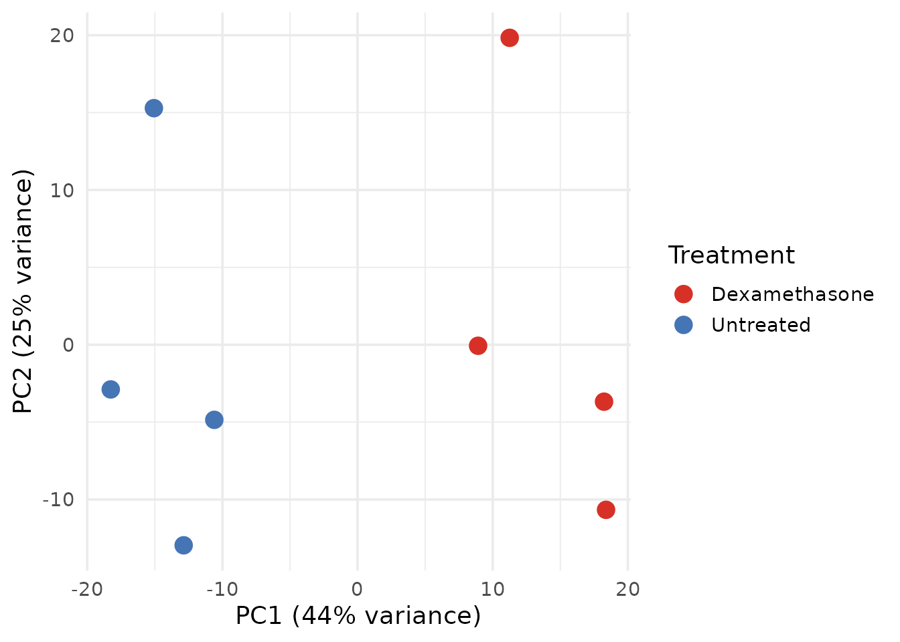
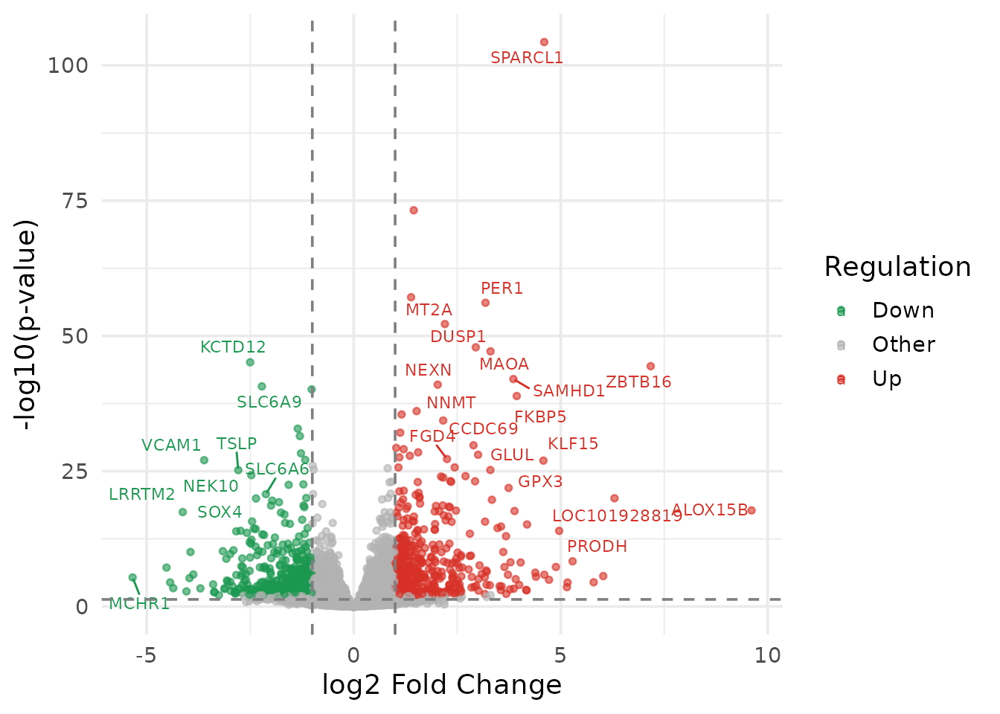
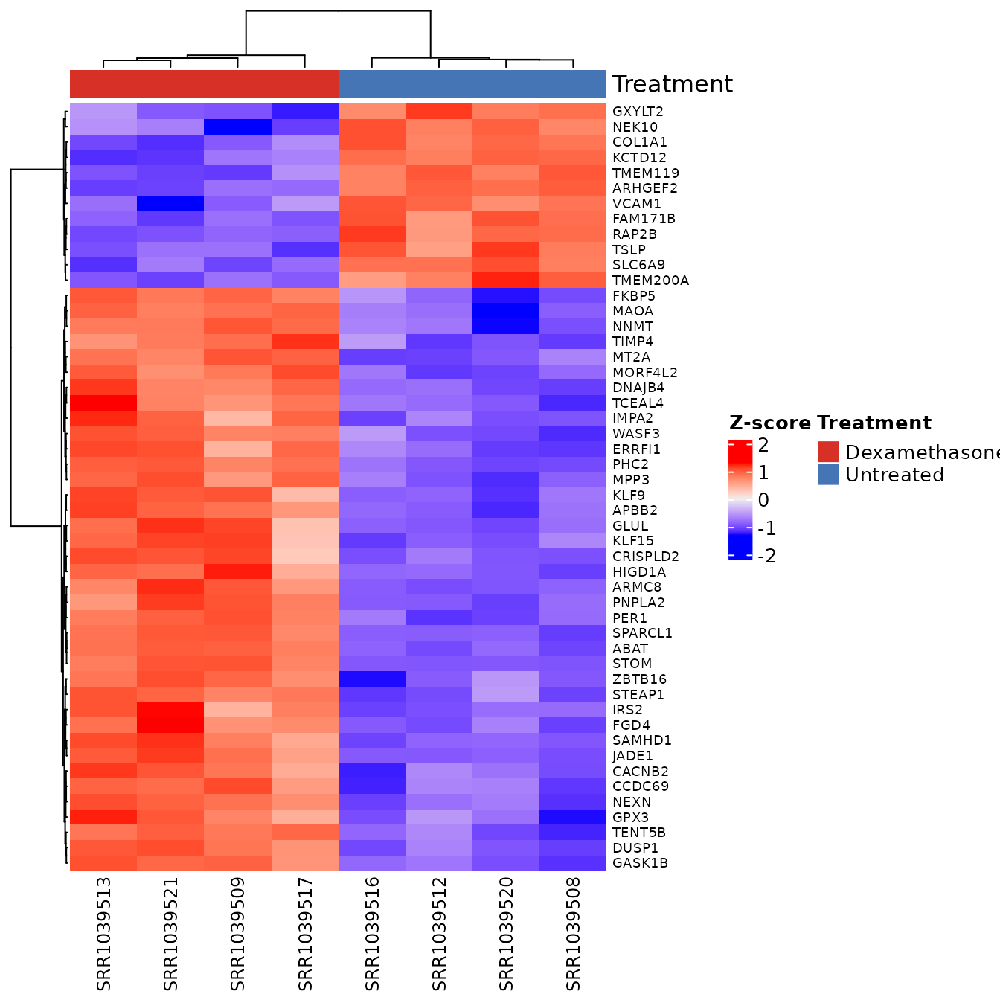
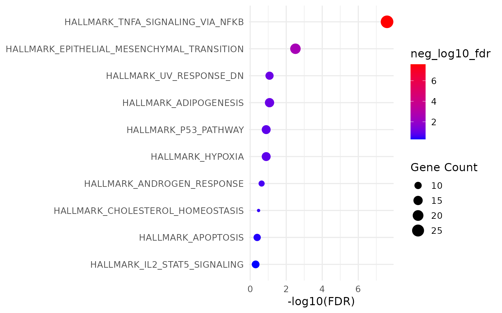
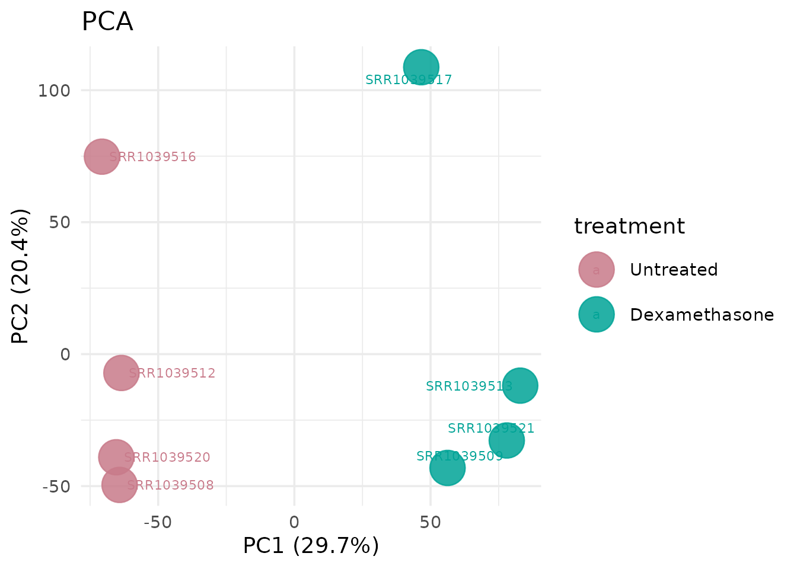
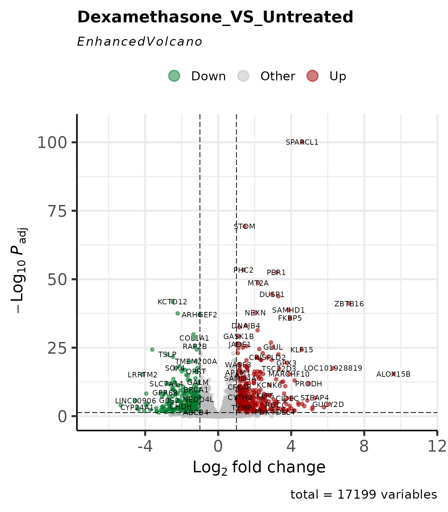
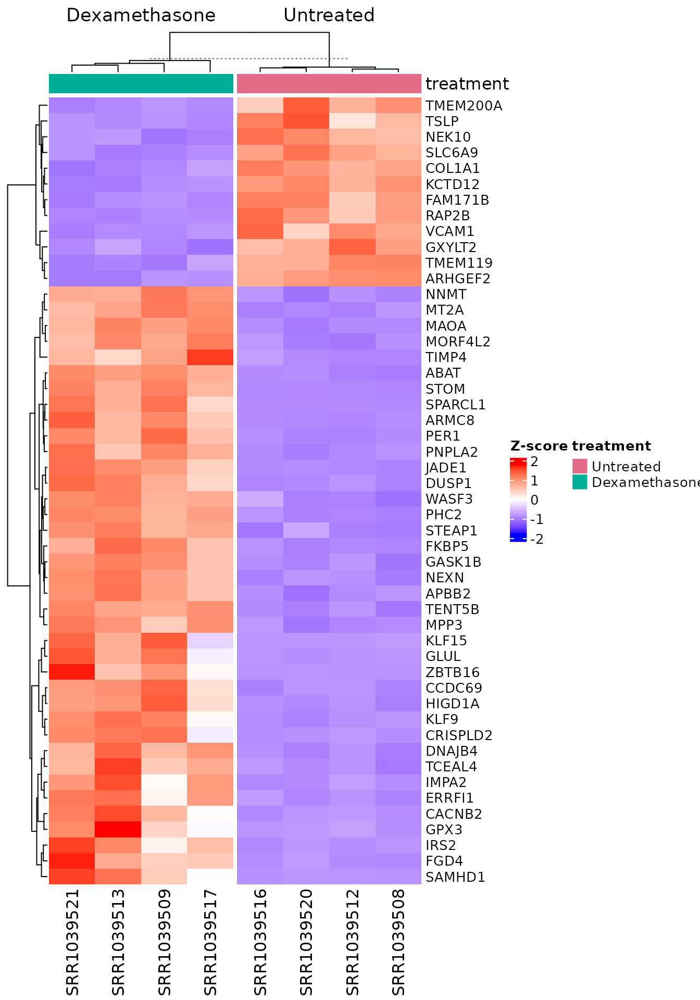
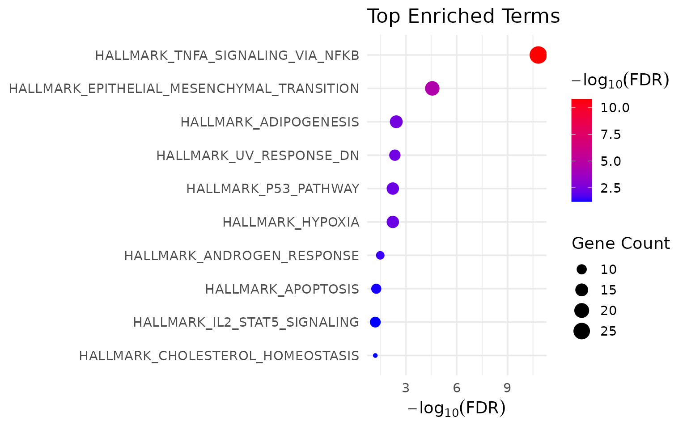
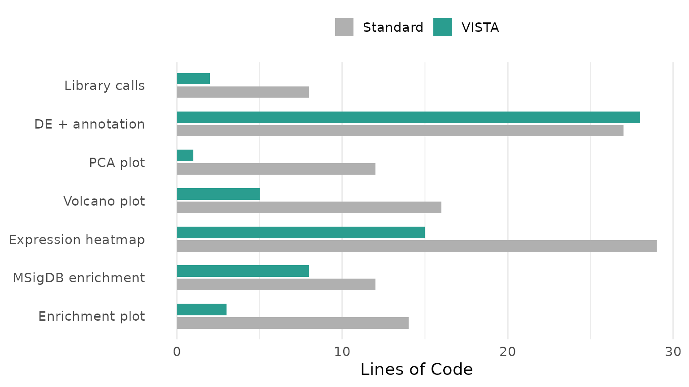

# Code Economy: VISTA vs. Standard R Workflows

## Motivation

A standard RNA-seq differential expression analysis – from raw counts to
publication-ready figures and enrichment results – requires assembling
many packages (11 in the version below), each with its own data
structures, naming conventions, and implicit assumptions. The user is
responsible for:

- **Data plumbing**: converting between `DESeqDataSet`, `DGEList`, data
  frames, matrices, and tibbles at every interface boundary
- **Identifier management**: gene IDs must be stripped, mapped, and
  re-mapped at each stage (DE, annotation, enrichment, visualisation)
- **State tracking**: cutoffs, method settings, comparison names, and
  color schemes are scattered across script variables with no structured
  persistence
- **Visual consistency**: colours, axis labels, and themes must be
  manually coordinated across dozens of ggplot2 calls

None of these steps involve scientific reasoning. They are engineering
overhead. VISTA eliminates them.

This vignette makes that claim concrete: we perform the **same
analysis** twice on the **same data** – once with standard packages,
once with VISTA – and measure the difference.

**How the code is counted.** Every tally in this vignette is computed
when the vignette is built, from the source of its own code chunks; none
is typed by hand. A *line* is a line that is neither blank nor a pure
comment. A *package* is one that a workflow attaches with
[`library()`](https://rdrr.io/r/base/library.html) or
[`require()`](https://rdrr.io/r/base/library.html) or calls with
`pkg::`. Packages that ship with R are not counted, and
[`library(VISTA)`](https://github.com/cparsania/VISTA) counts like any
other [`library()`](https://rdrr.io/r/base/library.html) call. The data
chunk below is shared by both workflows and counted for neither; apart
from the packages it attaches (airway and org.Hs.eg.db), each workflow
attaches what its own code needs, so either runs on its own after that
chunk. A step’s package count is the packages it adds, so the steps sum
to the workflow’s total. The counting code is shown in the
[appendix](#counting-code).

Workflow A is written by hand for this comparison. Its figures are
equivalent in kind to VISTA’s (a PCA plot, a volcano plot, a heatmap of
the top 50 genes and a Hallmark enrichment plot, all from the same
DESeq2 results), not identical in every default: point labels, colours
and heatmap clustering, for example, differ.

## Data

We use the airway dataset (Himes et al. 2014): 8 samples of human airway
smooth muscle cells, 4 treated with dexamethasone, 4 untreated.

``` r

library(airway)
library(org.Hs.eg.db)

data("airway", package = "airway")

counts_matrix <- SummarizedExperiment::assay(airway, "counts")
sample_meta   <- as.data.frame(SummarizedExperiment::colData(airway))
sample_meta$treatment <- ifelse(sample_meta$dex == "trt", "Dexamethasone", "Untreated")
```

## Workflow A: Standard Packages

The code below uses **only** established Bioconductor and CRAN packages
– DESeq2, ggplot2, ggrepel, dplyr, tibble, clusterProfiler, msigdbr,
AnnotationDbi, ComplexHeatmap, circlize, and forcats. This is
representative of real analysis scripts found in published supplementary
materials.

``` r

library(DESeq2)
library(ggplot2)
library(ggrepel)
library(dplyr)
library(tibble)
library(clusterProfiler)
library(msigdbr)
library(AnnotationDbi)
```

**8 library calls** before a single line of analysis.

### Step 1: Differential Expression (Standard)

``` r

# Build DESeqDataSet
dds <- DESeqDataSetFromMatrix(
  countData = counts_matrix,
  colData   = sample_meta,
  design    = ~ treatment
)

# Filter low-count genes
keep <- rowSums(counts(dds) >= 10) >= 2
dds  <- dds[keep, ]

# Run DE pipeline
dds <- DESeq(dds)

# Extract results
res <- results(dds, contrast = c("treatment", "Dexamethasone", "Untreated"))
res_df <- as.data.frame(res) %>%
  rownames_to_column("gene_id") %>%
  mutate(
    regulation = case_when(
      log2FoldChange >=  1 & padj < 0.05 ~ "Up",
      log2FoldChange <= -1 & padj < 0.05 ~ "Down",
      TRUE ~ "Other"
    )
  )

# Get normalized counts for downstream plots
norm_mat <- counts(dds, normalized = TRUE)
```

**19 lines.** The user must know: `DESeqDataSetFromMatrix`, formula
syntax, manual filtering logic,
[`results()`](https://rdrr.io/pkg/DESeq2/man/results.html) contrast
specification, fold-change and p-value cutoff application, and
regulation classification.

### Step 2: Gene Annotation (Standard)

``` r

# Map Ensembl IDs to gene symbols
gene_symbols <- mapIds(
  org.Hs.eg.db,
  keys    = res_df$gene_id,
  keytype = "ENSEMBL",
  column  = "SYMBOL",
  multiVals = "first"
)

res_df$SYMBOL <- gene_symbols[res_df$gene_id]
```

**8 lines.** The user must handle
[`mapIds()`](https://rdrr.io/pkg/AnnotationDbi/man/AnnotationDb-class.html),
know the correct keytype, and deal with multi-mapping.

### Step 3: PCA Plot (Standard)

``` r

# Variance-stabilising transform
vsd <- vst(dds, blind = FALSE)

# Extract PCA data
pca_data <- plotPCA(vsd, intgroup = "treatment", returnData = TRUE)
pct_var  <- round(100 * attr(pca_data, "percentVar"))

# Build ggplot manually
ggplot(pca_data, aes(x = PC1, y = PC2, color = treatment)) +
  geom_point(size = 4) +
  labs(
    x = paste0("PC1 (", pct_var[1], "% variance)"),
    y = paste0("PC2 (", pct_var[2], "% variance)"),
    color = "Treatment"
  ) +
  scale_color_manual(values = c("Untreated" = "#4575B4", "Dexamethasone" = "#D73027")) +
  theme_minimal(base_size = 14)
```



**12 lines.** The user must know:
[`vst()`](https://rdrr.io/pkg/DESeq2/man/vst.html),
[`plotPCA()`](https://rdrr.io/pkg/BiocGenerics/man/plotPCA.html) with
`returnData`, how to extract percent variance from attributes, manual
ggplot2 construction, and hardcoded colour assignment.

### Step 4: Volcano Plot (Standard)

``` r

volcano_df <- res_df %>%
  mutate(
    neg_log10_p = -log10(pvalue),
    label = ifelse(
      abs(log2FoldChange) > 2 & padj < 0.01 & !is.na(SYMBOL),
      SYMBOL, ""
    )
  )

ggplot(volcano_df, aes(x = log2FoldChange, y = neg_log10_p, color = regulation)) +
  geom_point(alpha = 0.6, size = 1.2) +
  geom_text_repel(aes(label = label), size = 3, max.overlaps = 15) +
  geom_vline(xintercept = c(-1, 1), linetype = "dashed", color = "grey50") +
  geom_hline(yintercept = -log10(0.05), linetype = "dashed", color = "grey50") +
  scale_color_manual(values = c(Up = "#D73027", Down = "#1A9850", Other = "grey70")) +
  labs(x = "log2 Fold Change", y = "-log10(p-value)", color = "Regulation") +
  theme_minimal(base_size = 14)
```



**16 lines.** Manual data preparation, manual label logic, manual
threshold lines, manual colour mapping.

### Step 5: Expression Heatmap (Standard)

``` r

library(ComplexHeatmap)
library(circlize)

# Select top DE genes
top_genes <- res_df %>%
  filter(regulation != "Other") %>%
  arrange(padj) %>%
  head(50) %>%
  pull(gene_id)

# Z-score transform
mat <- norm_mat[top_genes, ]
mat_z <- t(scale(t(log2(mat + 1))))

# Column annotation
col_ann <- HeatmapAnnotation(
  Treatment = sample_meta$treatment,
  col = list(Treatment = c("Untreated" = "#4575B4", "Dexamethasone" = "#D73027"))
)

# Map gene symbols for labels
row_labels <- ifelse(
  !is.na(gene_symbols[top_genes]),
  gene_symbols[top_genes],
  top_genes
)

Heatmap(
  mat_z,
  name = "Z-score",
  top_annotation = col_ann,
  row_labels = row_labels,
  show_row_names = TRUE,
  row_names_gp = gpar(fontsize = 7),
  column_names_gp = gpar(fontsize = 9),
  clustering_distance_rows = "euclidean",
  clustering_method_rows = "ward.D2"
)
```



**29 lines.** The user must: load 2 more packages, manually select top
genes, compute z-scores, construct `HeatmapAnnotation` with manually
repeated colours, map gene symbols for row labels, and configure
[`Heatmap()`](https://rdrr.io/pkg/ComplexHeatmap/man/Heatmap.html) with
8 named arguments.

### Step 6: MSigDB Enrichment (Standard)

``` r

# Get upregulated gene symbols
up_genes <- res_df %>%
  filter(regulation == "Up", !is.na(SYMBOL)) %>%
  pull(SYMBOL) %>%
  unique()

# Fetch Hallmark gene sets
hallmark_sets <- msigdbr(species = "Homo sapiens", category = "H")
hallmark_t2g  <- hallmark_sets[, c("gs_name", "gene_symbol")]

# Run enrichment
enrich_result <- enricher(
  gene     = up_genes,
  TERM2GENE = hallmark_t2g,
  pvalueCutoff = 0.05,
  qvalueCutoff = 0.2
)
```

**12 lines.** The user must: filter and extract gene symbols manually,
know the msigdbr column names, construct the TERM2GENE data frame, and
call
[`enricher()`](https://rdrr.io/pkg/clusterProfiler/man/enricher.html)
with correct parameters.

### Step 7: Enrichment Plot (Standard)

``` r

if (!is.null(enrich_result) && nrow(enrich_result@result) > 0) {
  enrich_df <- enrich_result@result %>%
    arrange(p.adjust) %>%
    head(10) %>%
    mutate(
      Description = forcats::fct_reorder(Description, -log10(p.adjust)),
      neg_log10_fdr = -log10(p.adjust)
    )

  ggplot(enrich_df, aes(x = neg_log10_fdr, y = Description)) +
    geom_point(aes(size = Count, color = neg_log10_fdr)) +
    scale_color_gradient(low = "blue", high = "red") +
    labs(x = "-log10(FDR)", y = NULL, size = "Gene Count") +
    theme_minimal(base_size = 13)
}
```



**14 lines.** Manual slot extraction, manual factor reordering, manual
ggplot2 construction.

### Standard Workflow: Summary

``` r

knitr::kable(
  standard_counts[, c("Step", "Lines", "Packages")],
  caption = paste0("Standard workflow: ", total_std, " lines, ", total_pkg, " packages"),
  align = c("l", "r", "r")
)
```

| Step               | Lines | Packages |
|:-------------------|------:|---------:|
| Library calls      |     8 |        8 |
| DE + annotation    |    27 |        0 |
| PCA plot           |    12 |        0 |
| Volcano plot       |    16 |        0 |
| Expression heatmap |    29 |        2 |
| MSigDB enrichment  |    12 |        0 |
| Enrichment plot    |    14 |        1 |

Standard workflow: 118 lines, 11 packages {.table}

**Total: 118 lines of code, 11 packages used (DESeq2, ggplot2, ggrepel,
dplyr, tibble, clusterProfiler, msigdbr, AnnotationDbi, ComplexHeatmap,
circlize, and forcats).**

Additional cognitive costs not captured in line count:

- **Data structure conversions** at each interface (matrix -\>
  DESeqDataSet -\> results -\> data.frame -\> filtered subset)
- **1 ID-mapping call**
  ([`mapIds()`](https://rdrr.io/pkg/AnnotationDbi/man/AnnotationDb-class.html)),
  whose symbols are then carried by hand into the volcano labels, the
  enrichment input and the heatmap row labels
- **3 hand-typed colour vectors** (PCA plot, Volcano plot, and
  Expression heatmap steps), kept consistent by hand
- **No structured persistence** (all state lives in script variables)

------------------------------------------------------------------------

## Workflow B: VISTA

The same analysis, same data, same kinds of output.

``` r

library(VISTA)
library(dplyr)  # for reshaping the inputs below
```

**2 library calls.** dplyr is attached here too because the next step
reshapes the inputs with it; without it, this workflow would rely on
Workflow A having attached it.

### Steps 1–2: Differential Expression + Annotation

``` r

# Reshape the shared inputs into the tables create_vista() expects
count_data <- as.data.frame(counts_matrix) %>%
  tibble::as_tibble() %>%
  mutate(gene_id = rownames(counts_matrix)) %>%
  select(gene_id, everything())

sample_info <- sample_meta %>%
  tibble::as_tibble() %>%
  rename(sample_names = Run) %>%
  mutate(sample_names = as.character(sample_names))

# One call: DE + filtering + normalization + regulation classification
vista <- create_vista(
  counts            = count_data,
  sample_info       = sample_info,
  column_geneid     = "gene_id",
  group_column      = "treatment",
  group_numerator   = "Dexamethasone",
  group_denominator = "Untreated",
  method            = "deseq2",
  min_counts        = 10,
  min_replicates    = 2,
  log2fc_cutoff     = 1.0,
  pval_cutoff       = 0.05,
  p_value_type      = "padj"
)

# One call: gene annotation
vista <- set_rowdata(
  vista,
  orgdb   = org.Hs.eg.db,
  columns = c("SYMBOL", "GENENAME", "ENTREZID"),
  keytype = "ENSEMBL"
)
```

**28 lines**, including the reshaping of the shared inputs that
[`create_vista()`](https://cparsania.github.io/VISTA/reference/create_vista.md)
needs.

[`create_vista()`](https://cparsania.github.io/VISTA/reference/create_vista.md)
performed: count filtering, DESeq2 pipeline execution, normalized count
extraction, fold-change/p-value thresholding, regulation classification,
colour palette assignment, and metadata persistence – in one call.
[`set_rowdata()`](https://cparsania.github.io/VISTA/reference/set_rowdata.md)
handled all ID mapping.

### Step 3: PCA Plot

``` r

get_pca_plot(vista, label = TRUE)
```



**1 line.** Colors are inherited from the VISTA object. Axis labels with
variance percentages are generated automatically.

### Step 4: Volcano Plot

``` r

get_volcano_plot(
  vista,
  sample_comparison = names(comparisons(vista))[1],
  display_id = "SYMBOL"
)
```



**5 lines.** Threshold lines, gene labels, and colour scheme are derived
from the stored cutoffs and palette.

### Step 5: Expression Heatmap

``` r

# Select top 50 DE genes using VISTA accessor
comp_name <- names(comparisons(vista))[1]
de_tbl    <- comparisons(vista)[[comp_name]]
top_genes <- head(de_tbl$gene_id[de_tbl$regulation != "Other"][
  order(de_tbl$padj[de_tbl$regulation != "Other"])
], 50)

get_expression_heatmap(
  x               = vista,
  sample_group    = c("Untreated", "Dexamethasone"),
  genes            = top_genes,
  value_transform  = "zscore",
  display_id       = "SYMBOL",
  annotate_columns = TRUE,
  show_row_names   = TRUE,
  summarise_replicates  = FALSE  
)
```



**15 lines.** Z-score transformation, column annotation with consistent
colours, and symbol mapping are handled internally.

### Step 6: MSigDB Enrichment

``` r

msig_up <- get_msigdb_enrichment(
  vista,
  sample_comparison = names(comparisons(vista))[1],
  regulation  = "Up",
  msigdb_category = "H",
  species     = "Homo sapiens",
  from_type   = "ENSEMBL"
)
```

**8 lines.** Gene extraction, ID conversion, TERM2GENE construction, and
enrichment execution are handled internally.

### Step 7: Enrichment Plot

``` r

if (!is.null(msig_up$enrich) && nrow(msig_up$enrich@result) > 0) {
  get_enrichment_plot(msig_up$enrich, top_n = 10)
}
```



**3 lines.**

### VISTA Workflow: Summary

``` r

knitr::kable(
  vista_counts[, c("Step", "Lines", "Packages")],
  caption = paste0("VISTA workflow: ", total_vista, " lines, ", n_of(total_pkg_vista, "package")),
  align = c("l", "r", "r")
)
```

| Step               | Lines | Packages |
|:-------------------|------:|---------:|
| Library calls      |     2 |        2 |
| DE + annotation    |    28 |        1 |
| PCA plot           |     1 |        0 |
| Volcano plot       |     5 |        0 |
| Expression heatmap |    15 |        0 |
| MSigDB enrichment  |     8 |        0 |
| Enrichment plot    |     3 |        0 |

VISTA workflow: 62 lines, 3 packages {.table}

**Total: 62 lines of code, 3 packages used (VISTA, dplyr, and tibble).**

------------------------------------------------------------------------

## Side-by-Side Comparison

| Step               | Standard (lines) | VISTA (lines) | Reduction |
|:-------------------|-----------------:|--------------:|----------:|
| Library calls      |                8 |             2 |       75% |
| DE + annotation    |               27 |            28 |       -4% |
| PCA plot           |               12 |             1 |       92% |
| Volcano plot       |               16 |             5 |       69% |
| Expression heatmap |               29 |            15 |       48% |
| MSigDB enrichment  |               12 |             8 |       33% |
| Enrichment plot    |               14 |             3 |       79% |
| Total              |              118 |            62 |       47% |

Lines of code: Standard (118) vs. VISTA (62) {.table}

Overall, Workflow B is 47% shorter than Workflow A (62 lines against
118) and uses 3 packages against 11. The saving is not uniform: in the
DE + annotation step VISTA needs 28 lines against 27, because the inputs
must be reshaped for
[`create_vista()`](https://cparsania.github.io/VISTA/reference/create_vista.md)
and its settings are passed as named arguments. Most of the saving is in
the plotting and enrichment steps.



## Beyond Line Count

Line count is a proxy. The deeper value is in what the user **does not
have to think about**:

### Data structure conversions

| Standard workflow | VISTA |
|----|----|
| matrix -\> `DESeqDataSet` | matrix and sample table -\> tibbles, once, as [`create_vista()`](https://cparsania.github.io/VISTA/reference/create_vista.md) input |
| `DESeqResults` -\> data.frame | Stored in metadata |
| data.frame -\> filtered tibble | Accessor: [`comparisons()`](https://cparsania.github.io/VISTA/reference/VISTA-accessors.md), then subset by hand for the heatmap genes |
| matrix -\> z-score matrix | `value_transform = "zscore"` |
| tibble -\> gene vector for enrichment | Handled by [`get_msigdb_enrichment()`](https://cparsania.github.io/VISTA/reference/get_msigdb_enrichment.md) |

These are not counted, because what counts as a conversion is a matter
of judgement. Neither workflow is free of them: VISTA’s inputs are
reshaped once before
[`create_vista()`](https://cparsania.github.io/VISTA/reference/create_vista.md),
and after that, results are read through
[`comparisons()`](https://cparsania.github.io/VISTA/reference/VISTA-accessors.md)
and the VISTA plotting and enrichment functions.

### Identifier mappings

| Standard workflow | VISTA |
|----|----|
| `mapIds(org.Hs.eg.db, keys, "ENSEMBL", "SYMBOL")` | `set_rowdata(orgdb, keytype)` (once) |
| Manual symbol extraction for enrichment | `from_type = "ENSEMBL"` (auto-converted) |
| Manual symbol lookup for plot labels | `display_id = "SYMBOL"` (every plot) |

**ID-mapping calls: 1 in Workflow A
([`mapIds()`](https://rdrr.io/pkg/AnnotationDbi/man/AnnotationDb-class.html)),
1 in Workflow B
([`set_rowdata()`](https://cparsania.github.io/VISTA/reference/set_rowdata.md)).**
Both map identifiers once. The difference is what follows: Workflow A
carries the symbols by hand into the volcano labels, the enrichment
input and the heatmap row labels, while VISTA’s functions take the
identifier type as a parameter.

### Color consistency: guaranteed vs. manual

In the standard workflow, the user defines colours in each plot:

``` r

# PCA: manually set
scale_color_manual(values = c("Untreated" = "#4575B4", "Dexamethasone" = "#D73027"))

# Heatmap: manually set (must match PCA)
col = list(Treatment = c("Untreated" = "#4575B4", "Dexamethasone" = "#D73027"))

# Volcano: different variable, different palette entirely
scale_color_manual(values = c(Up = "#D73027", Down = "#1A9850", Other = "grey70"))
```

If any of these diverge, figures become inconsistent. In VISTA, group
colours are set once at object creation and propagated to every
downstream plot automatically.

Counted over all its steps, Workflow A’s code types 3 colour vectors and
11 colour values by hand (hex codes and R colour names, including the
threshold lines and the enrichment gradient); Workflow B’s types 0
colour vectors and 0 colour values.

### State persistence: object vs. variables

``` r

# Standard: state is scattered
dds            # DESeqDataSet
res            # DESeqResults
res_df         # data.frame with regulation column
norm_mat       # normalized counts matrix
gene_symbols   # named character vector
vsd            # variance-stabilised transform
```

Six separate variables. If the script is interrupted and restarted, the
user must re-run everything from the top.

``` r

# VISTA: state is in one object
vista          # everything
```

One object. `saveRDS(vista, "analysis.rds")` preserves the full analysis
state. Any plot or enrichment can be reproduced from this object alone.

## Summary

| Metric | Standard | VISTA |
|:---|:--:|:--:|
| Total lines of code | 118 | 62 |
| Packages used | 11 | 3 |
| ID-mapping calls | 1 ([`mapIds()`](https://rdrr.io/pkg/AnnotationDbi/man/AnnotationDb-class.html)) | 1 ([`set_rowdata()`](https://cparsania.github.io/VISTA/reference/set_rowdata.md)) |
| Hand-typed colour vectors | 3 | 0 |
| Persistent analysis objects | 0 (scripts) | 1 (S4) |

Workflow complexity comparison {.table}

VISTA does not introduce new statistical methods:
[`create_vista()`](https://cparsania.github.io/VISTA/reference/create_vista.md)
runs DESeq2, edgeR or limma-voom rather than reimplementing them. The
check below compares the DESeq2 results of the two workflows above gene
by gene, counting for each column the genes whose values are not exactly
equal (a missing value matches only a missing value).

``` r

vista_de <- comparisons(vista)[[1]]
std_de   <- as.data.frame(res)[vista_de$gene_id, ]
std_de$regulation <- res_df$regulation[match(vista_de$gene_id, res_df$gene_id)]
same_genes <- setequal(vista_de$gene_id, rownames(res)) &&
  nrow(vista_de) == nrow(res)

# VISTA column = standard column
de_columns <- c(baseMean = "baseMean", log2fc = "log2FoldChange",
                lfcSE = "lfcSE", stat = "stat", pvalue = "pvalue",
                padj = "padj", regulation = "regulation")
genes_differing <- vapply(names(de_columns), function(col) {
  a <- vista_de[[col]]
  b <- std_de[[de_columns[[col]]]]
  sum(xor(is.na(a), is.na(b)) | (!is.na(a) & !is.na(b) & a != b))
}, integer(1))

same_genes
#> [1] TRUE
genes_differing
#>   baseMean     log2fc      lfcSE       stat     pvalue       padj regulation 
#>          0          0          0          0          0          0          0
```

On this data, the two workflows test the same 17199 genes and give
identical results in every column compared.

What VISTA eliminates is the engineering overhead between these
computations: the data reshaping, identifier juggling, colour
coordination, and state management that take up scripting time without
contributing to scientific reasoning.

## Counting code

Every tally above is computed by this code, which reads the vignette’s
own chunks with `knitr::knit_code$get()`.

``` r

# The counting rule behind every code tally in this vignette. This chunk is
# the rule's only copy: a script that reports these tallies elsewhere (such
# as the manuscript's count_code_economy.R) extracts this chunk from this
# file and runs it, so both count alike.

# The chunks that make up each step of each workflow. The shared
# `load-data` chunk is counted for neither workflow.
economy_steps <- list(
  Standard = list(
    "Library calls"      = "standard-packages",
    "DE + annotation"    = c("standard-de", "standard-annotation"),
    "PCA plot"           = "standard-pca",
    "Volcano plot"       = "standard-volcano",
    "Expression heatmap" = "standard-heatmap",
    "MSigDB enrichment"  = "standard-enrichment",
    "Enrichment plot"    = "standard-enrichment-plot"
  ),
  VISTA = list(
    "Library calls"      = "vista-packages",
    "DE + annotation"    = "vista-de",
    "PCA plot"           = "vista-pca",
    "Volcano plot"       = "vista-volcano",
    "Expression heatmap" = "vista-heatmap",
    "MSigDB enrichment"  = "vista-enrichment",
    "Enrichment plot"    = "vista-enrichment-plot"
  )
)

# Packages that ship with R itself are never counted.
base_r_pkgs <- c("base", "compiler", "datasets", "graphics", "grDevices",
                 "grid", "methods", "parallel", "splines", "stats",
                 "stats4", "tcltk", "tools", "utils")

# Calls that map gene identifiers. AnnotationDbi's select() is told apart
# from dplyr's select() by its `keytype` argument.
id_mapping_fns <- c("mapIds", "bitr", "set_rowdata")

# Lines: a line counts if it is not blank and not a pure comment.
count_lines <- function(code) {
  code <- trimws(code)
  sum(nzchar(code) & !startsWith(code, "#"))
}

# Every call in a piece of code, nested calls included.
code_calls <- function(code) {
  calls <- list()
  walk <- function(x) {
    calls[[length(calls) + 1L]] <<- x
    for (i in seq_along(x)) if (is.call(x[[i]])) walk(x[[i]])
  }
  for (e in parse(text = code, keep.source = FALSE)) if (is.call(e)) walk(e)
  calls
}

# The function a call invokes: "f" for both f() and pkg::f().
call_fun <- function(cl) {
  f <- cl[[1]]
  if (is.symbol(f)) return(as.character(f))
  if (is.call(f) && is.symbol(f[[1]]) &&
      as.character(f[[1]]) %in% c("::", ":::")) return(as.character(f[[3]]))
  NA_character_
}

# Packages: attached with library()/require() or called with pkg::.
code_packages <- function(code) {
  pkgs <- character()
  for (cl in code_calls(code)) {
    fn <- call_fun(cl)
    if (fn %in% c("library", "require") && length(cl) > 1L) {
      pkg <- if (is.null(cl$package)) cl[[2]] else cl$package
      pkgs <- c(pkgs, as.character(pkg))
    } else if (fn %in% c("::", ":::")) {
      pkgs <- c(pkgs, as.character(cl[[2]]))
    }
  }
  setdiff(unique(pkgs), base_r_pkgs)
}

# Colour literals: a hex code or an R colour name, typed as a string.
is_colour <- function(s) {
  grepl("^#([[:xdigit:]]{3}|[[:xdigit:]]{6}|[[:xdigit:]]{8})$", s) ||
    s %in% grDevices::colors()
}
colour_args <- function(cl) {
  n <- 0L
  for (i in seq_along(cl)[-1L]) {
    if (is.character(cl[[i]]) && length(cl[[i]]) == 1L && is_colour(cl[[i]])) {
      n <- n + 1L
    }
  }
  n
}

# All tallies for one piece of code.
code_tally <- function(code) {
  calls   <- code_calls(code)
  fns     <- vapply(calls, call_fun, character(1))
  colours <- vapply(calls, colour_args, integer(1))
  keytype <- vapply(calls, function(cl) "keytype" %in% names(cl), logical(1))
  id_map  <- fns %in% id_mapping_fns | (fns %in% "select" & keytype)
  list(
    lines          = count_lines(code),
    packages       = code_packages(code),
    library_calls  = sum(fns %in% c("library", "require")),
    id_mapping     = fns[id_map],
    colour_vectors = sum(fns %in% "c" & colours > 0L),
    colour_values  = sum(colours)
  )
}

# One row per step and workflow. `get_code(label)` returns a chunk's source.
# A step's `packages` are those not already counted at an earlier step, so
# the steps of a workflow sum to its distinct packages.
code_economy <- function(get_code, steps = economy_steps) {
  rows <- list()
  for (wf in names(steps)) {
    seen <- character()
    for (st in names(steps[[wf]])) {
      code <- unlist(lapply(steps[[wf]][[st]], function(label) {
        chunk <- get_code(label)
        if (is.null(chunk) || count_lines(chunk) == 0L) {
          stop("Chunk '", label, "' is missing or has no countable code.")
        }
        as.character(chunk)
      }))
      tally <- code_tally(code)
      new_pkgs <- setdiff(tally$packages, seen)
      seen <- c(seen, new_pkgs)
      rows[[length(rows) + 1L]] <- data.frame(
        step             = st,
        workflow         = wf,
        lines            = tally$lines,
        packages         = length(new_pkgs),
        package_names    = paste(new_pkgs, collapse = ", "),
        library_calls    = tally$library_calls,
        id_mapping_calls = length(tally$id_mapping),
        id_mapping_fns   = paste(unique(tally$id_mapping), collapse = ", "),
        colour_vectors   = tally$colour_vectors,
        colour_values    = tally$colour_values
      )
    }
  }
  do.call(rbind, rows)
}

# One "Total" row per workflow.
economy_totals <- function(economy) {
  per_wf <- split(economy, factor(economy$workflow, unique(economy$workflow)))
  do.call(rbind, lapply(per_wf, function(d) {
    join <- function(x) paste(unique(x[nzchar(x)]), collapse = ", ")
    data.frame(
      step             = "Total",
      workflow         = d$workflow[1],
      lines            = sum(d$lines),
      packages         = sum(d$packages),
      package_names    = join(d$package_names),
      library_calls    = sum(d$library_calls),
      id_mapping_calls = sum(d$id_mapping_calls),
      id_mapping_fns   = join(d$id_mapping_fns),
      colour_vectors   = sum(d$colour_vectors),
      colour_values    = sum(d$colour_values),
      row.names        = NULL
    )
  }))
}
# knitr has parsed every chunk before running any, so the whole document's
# code is available here.
economy       <- code_economy(function(label) knitr::knit_code$get(label))
economy_total <- economy_totals(economy)

# Shorthands for the counts quoted in the text.
eco <- function(workflow, step, what = "lines") {
  economy[economy$workflow == workflow & economy$step == step, what]
}
tot <- function(workflow, what = "lines") {
  economy_total[economy_total$workflow == workflow, what]
}
chunk_lines <- function(label) count_lines(knitr::knit_code$get(label))
named_args <- function(label, fn) {
  calls <- code_calls(knitr::knit_code$get(label))
  cl <- calls[[match(fn, vapply(calls, call_fun, character(1)))]]
  sum(nzchar(names(cl)))
}
n_of <- function(n, what) paste(n, if (n == 1) what else paste0(what, "s"))
pct_less <- function(standard, vista) {
  paste0(round(100 * (standard - vista) / standard), "%")
}
pkg_list <- function(workflow) {
  knitr::combine_words(strsplit(tot(workflow, "package_names"), ", ")[[1]])
}
fn_list <- function(fns) {
  if (!nzchar(fns)) return("none")
  knitr::combine_words(paste0("`", strsplit(fns, ", ")[[1]], "()`"))
}
steps_with <- function(workflow, what) {
  economy$step[economy$workflow == workflow & economy[[what]] > 0]
}

# Wording for the DESeq2 cross-check in the Summary section.
describe_de_check <- function(genes_differing, vista_de, std_de, same_genes) {
  if (!same_genes) {
    return("the two workflows do not test the same genes, so their results differ")
  }
  same <- names(genes_differing)[genes_differing == 0L]
  diff <- names(genes_differing)[genes_differing > 0L]
  if (!length(diff)) {
    return(paste0("the two workflows test the same ", nrow(vista_de),
                  " genes and give identical results in every column compared"))
  }
  out <- paste0(
    "the two workflows test the same genes and agree exactly in ",
    knitr::combine_words(paste0("`", same, "`")), " for all ",
    nrow(vista_de), " genes, and differ in ",
    knitr::combine_words(paste0("`", diff, "` (", genes_differing[diff],
                                " genes)"))
  )
  idx <- which(xor(is.na(vista_de$pvalue), is.na(std_de$pvalue)))
  if (identical(diff, "pvalue") && length(idx) == genes_differing[["pvalue"]] &&
      all(is.na(std_de$pvalue[idx])) && sum(is.na(std_de$pvalue)) == length(idx)) {
    out <- paste0(
      out, ". These are exactly the genes for which DESeq2 reports no ",
      "p-value (`NA`); for them the installed VISTA (",
      utils::packageVersion("VISTA"), ") stores a p-value of ",
      knitr::combine_words(unique(vista_de$pvalue[idx])),
      " while leaving `padj` as `NA`"
    )
  }
  out
}
```

## Session Information

``` r

sessionInfo()
#> R version 4.6.1 (2026-06-24)
#> Platform: x86_64-pc-linux-gnu
#> Running under: Ubuntu 24.04.5 LTS
#> 
#> Matrix products: default
#> BLAS:   /usr/lib/x86_64-linux-gnu/openblas-pthread/libblas.so.3 
#> LAPACK: /usr/lib/x86_64-linux-gnu/openblas-pthread/libopenblasp-r0.3.26.so;  LAPACK version 3.12.0
#> 
#> locale:
#>  [1] LC_CTYPE=C.UTF-8       LC_NUMERIC=C           LC_TIME=C.UTF-8       
#>  [4] LC_COLLATE=C.UTF-8     LC_MONETARY=C.UTF-8    LC_MESSAGES=C.UTF-8   
#>  [7] LC_PAPER=C.UTF-8       LC_NAME=C              LC_ADDRESS=C          
#> [10] LC_TELEPHONE=C         LC_MEASUREMENT=C.UTF-8 LC_IDENTIFICATION=C   
#> 
#> time zone: UTC
#> tzcode source: system (glibc)
#> 
#> attached base packages:
#> [1] grid      stats4    stats     graphics  grDevices utils     datasets 
#> [8] methods   base     
#> 
#> other attached packages:
#>  [1] VISTA_1.1.6                 circlize_0.4.18            
#>  [3] ComplexHeatmap_2.28.0       msigdbr_26.1.1             
#>  [5] clusterProfiler_4.20.2      tibble_3.3.1               
#>  [7] dplyr_1.2.1                 ggrepel_0.9.8              
#>  [9] ggplot2_4.0.3               DESeq2_1.52.0              
#> [11] org.Hs.eg.db_3.23.1         AnnotationDbi_1.74.0       
#> [13] airway_1.32.0               SummarizedExperiment_1.42.0
#> [15] Biobase_2.72.0              GenomicRanges_1.64.0       
#> [17] Seqinfo_1.2.0               IRanges_2.46.0             
#> [19] S4Vectors_0.50.3            BiocGenerics_0.58.1        
#> [21] generics_0.1.4              MatrixGenerics_1.24.0      
#> [23] matrixStats_1.5.0           BiocStyle_2.40.0           
#> 
#> loaded via a namespace (and not attached):
#>   [1] splines_4.6.1           ggplotify_0.1.4         polyclip_1.10-7        
#>   [4] enrichit_0.2.6          lifecycle_1.0.5         httr2_1.3.0            
#>   [7] rstatix_1.1.0           edgeR_4.10.6            doParallel_1.0.17      
#>  [10] processx_3.9.0          lattice_0.22-9          MASS_7.3-65            
#>  [13] backports_1.5.1         magrittr_2.0.5          limma_3.68.5           
#>  [16] sass_0.4.10             rmarkdown_2.32          jquerylib_0.1.4        
#>  [19] yaml_2.3.12             otel_0.2.0              ggtangle_0.1.4         
#>  [22] EnhancedVolcano_1.30.0  DBI_1.3.0               RColorBrewer_1.1-3     
#>  [25] abind_1.4-8             purrr_1.2.2             yulab.utils_0.2.5      
#>  [28] tweenr_2.0.3            rappdirs_0.3.4          aisdk_1.4.12           
#>  [31] gdtools_0.5.2           enrichplot_1.32.1       tidytree_0.4.8         
#>  [34] pkgdown_2.2.1           codetools_0.2-20        DelayedArray_0.38.2    
#>  [37] DOSE_4.6.0              ggforce_0.5.0           tidyselect_1.2.1       
#>  [40] shape_1.4.6.1           aplot_0.3.2             farver_2.1.2           
#>  [43] jsonlite_2.0.0          GetoptLong_1.1.1        Formula_1.2-6          
#>  [46] iterators_1.0.14        systemfonts_1.3.2       foreach_1.5.2          
#>  [49] tools_4.6.1             ggnewscale_0.5.2        treeio_1.36.1          
#>  [52] ragg_1.5.2              Rcpp_1.1.2              glue_1.8.1             
#>  [55] SparseArray_1.12.3      xfun_0.62               qvalue_2.44.0          
#>  [58] withr_3.0.3             BiocManager_1.30.27     fastmap_1.2.0          
#>  [61] GGally_2.4.0            callr_3.8.0             digest_0.6.39          
#>  [64] R6_2.6.1                gridGraphics_0.5-1      textshaping_1.0.5      
#>  [67] colorspace_2.1-4        GO.db_3.23.1            RSQLite_3.53.3         
#>  [70] tidyr_1.3.2             fontLiberation_0.1.0    httr_1.4.9             
#>  [73] htmlwidgets_1.6.4       S4Arrays_1.12.1         scatterpie_0.2.6       
#>  [76] ggstats_0.14.0          pkgconfig_2.0.3         gtable_0.3.6           
#>  [79] blob_1.3.0              S7_0.2.2                XVector_0.52.0         
#>  [82] htmltools_0.5.9         fontBitstreamVera_0.1.1 carData_3.0-6          
#>  [85] bookdown_0.48           clue_0.3-68             scales_1.4.0           
#>  [88] png_0.1-9               ggfun_0.2.2             knitr_1.52             
#>  [91] reshape2_1.4.5          rjson_0.2.23            nlme_3.1-169           
#>  [94] cachem_1.1.0            GlobalOptions_0.1.4     stringr_1.6.0          
#>  [97] parallel_4.6.1          desc_1.4.3              pillar_1.11.1          
#> [100] vctrs_0.7.3             ggpubr_1.0.0            car_3.1-5              
#> [103] tidydr_0.0.7            cluster_2.1.8.2         evaluate_1.0.5         
#> [106] cli_3.6.6               locfit_1.5-9.12         compiler_4.6.1         
#> [109] rlang_1.3.0             crayon_1.5.3            ggsignif_0.6.4         
#> [112] labeling_0.4.3          ps_1.9.3                plyr_1.8.9             
#> [115] forcats_1.0.1           fs_2.1.0                ggiraph_0.9.6          
#> [118] stringi_1.8.9           BiocParallel_1.46.0     assertthat_0.2.1       
#> [121] Biostrings_2.80.2       lazyeval_0.2.3          GOSemSim_2.38.3        
#> [124] fontquiver_0.2.1        Matrix_1.7-5            patchwork_1.3.2        
#> [127] bit64_4.8.6             KEGGREST_1.52.2         statmod_1.5.2          
#> [130] igraph_2.3.4            broom_1.0.13            memoise_2.0.1          
#> [133] bslib_0.12.0            ggtree_4.2.0            bit_4.6.0              
#> [136] ape_5.8-1               gson_0.2.2
```

## References

- Himes BE et al. (2014). “RNA-Seq transcriptome profiling identifies
  CRISPLD2 as a glucocorticoid responsive gene that modulates cytokine
  function in airway smooth muscle cells.” *PLoS One* 9(6): e99625.
- Love MI, Huber W, Anders S (2014). “Moderated estimation of fold
  change and dispersion for RNA-seq data with DESeq2.” *Genome Biology*
  15:550.
- Gu Z et al. (2016). “Complex heatmaps reveal patterns and correlations
  in multidimensional genomic data.” *Bioinformatics* 32(18):2847–2849.
- Wu T et al. (2021). “clusterProfiler 4.0: A universal enrichment tool
  for interpreting omics data.” *The Innovation* 2(3):100141.
